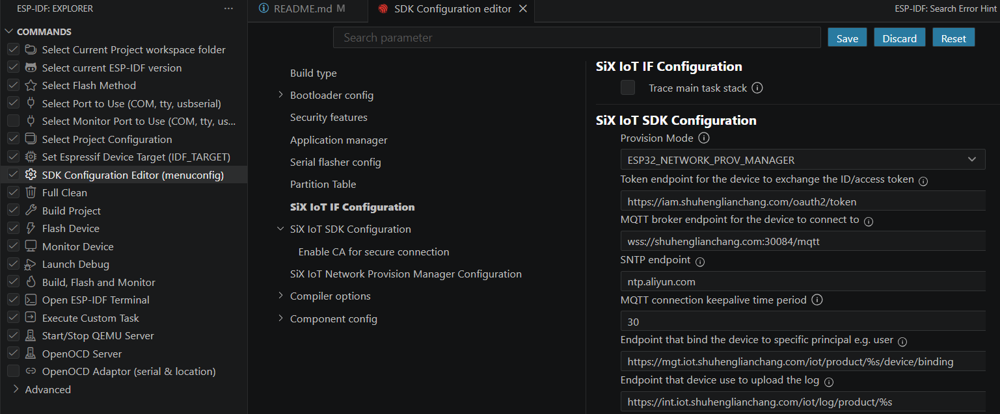

https://github.com/user-attachments/assets/9316cc08-838b-43ad-8750-62db06f7737c

[English](README.md)

**提示：** 本SDK可与[six-iot-sdk-android](https://github.com/Simple-intelligent-X/six-iot-sdk-android)无缝协同使用。

| 测试目标 | ESP32 | ESP32-C3 | ESP32-S3 |
| -------- | ----- | -------- | -------- |

**说明：** 本SDK旨在支持所有ESP32系列SoC芯片，只要目标芯片具备相应的硬件连接模块即可使用。本SDK使用的开发框架为**ESP-IDF v5.5.5**。

---

# 概述

本SDK是一款面向ESP32系列芯片的综合性开发工具包，支持ESP32-C3、ESP32-S3及其他ESP32系列芯片。通过提供成熟、可靠且可用于生产环境的功能模块，帮助开发者简化固件开发流程，提高开发效率。

主要功能包括：

- **网络配网（Network Provisioning）** 自动化设备配网流程。当用户通过配套应用扫描设备二维码后，设备即可接收相关配网信息，并自动触发本地配网流程。

- **MQTT连接服务（MQTT Connectivity）** 提供嵌入式连接服务，用于建立、维护和管理设备与产品MQTT消息服务器之间的安全连接。

- **设备影子服务（Shadow Service Interaction）** 通过管理与后端Device Shadow Service交互的相关Topic，简化设备与平台之间的状态同步。

- **日志服务（Log Service）** 自动收集并缓存设备本地日志，在确认网络连接正常后，将日志自动同步至云端基础设施。

- **OTA固件升级（Over-the-Air）** 提供可靠、安全的远程固件升级机制，支持设备在运行过程中进行固件更新、功能升级及问题修复。

---

# 快速开始

本SDK默认已完成相关配置，可直接与**SiX IoT Platform**及**SiX IDaaS & IAM**生态协同运行。

- **[SiX IoT Platform](https://web.iot.shuhenglianchang.com/index)** 用于管理产品生命周期及设备配网相关配置，例如设备唯一身份凭证（私钥）以及设备配网二维码。

- **[SiX IDaaS & IAM](https://web.iam.shuhenglianchang.com/index)** 负责整个生态中的设备身份认证及访问控制策略管理。

**建议：** 在开始设备集成之前，我们强烈建议您先阅读[快速入门文档](https://doc.iot.shuhenglianchang.com/quick-start/quick-start)，以便了解完整的接入流程。

---

# 集成指南

请按照以下步骤，在您的硬件设备上完成SDK集成与运行。

### 1. 配置SDK环境

通过`menuconfig`或对应的配置界面检查并调整SDK配置参数，具体如下图所示：

  

### 2. 配置设备身份与认证凭证

进入`device_certs/`目录，配置设备专属身份凭证、目标设备标识信息以及配网二维码相关元数据。

### 3. 将设备凭证烧录至目标开发板

请参考[Flash.zh-CN.md](Flash.zh-CN.md)中的详细操作步骤，将设备唯一身份认证信息安全地写入指定的NVS或其他存储分区。

### 4. 在IDE中运行并测试SDK

通过USB将ESP32开发板连接至电脑，打开您所使用的IDE（例如安装了ESP-IDF Extension的VS Code），然后编译并烧录固件。

您可以通过串口终端查看设备运行日志，以确认网络配网、云端连接及数据同步等任务是否已成功启动。

**注意：** 在正式生产部署环境中，建议自动化设备初始化流程，包括动态获取设备唯一身份凭证、自动生成目标分区表二进制文件，以及实现批量、规范化的设备烧录流程。

---

# 技术支持与反馈

如果您有技术问题、架构相关讨论，或对SiX IoT生态有任何建议，欢迎通过邮件联系我们：

- **技术支持（Engineering Support）：** stephen.yu@six-inno.cn

---

# 专属IoT平台部署

如果您需要专属企业级IoT平台部署、基础设施托管或私有云部署方案，请联系我们的解决方案团队：

- **企业服务（Enterprise Service）：** service@six-inno.cn